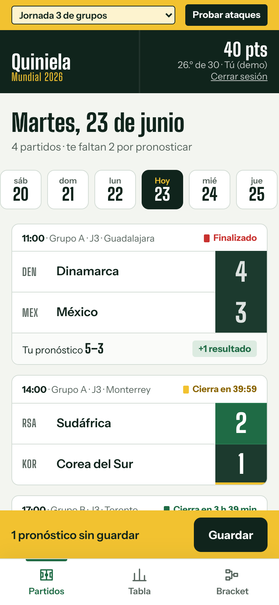
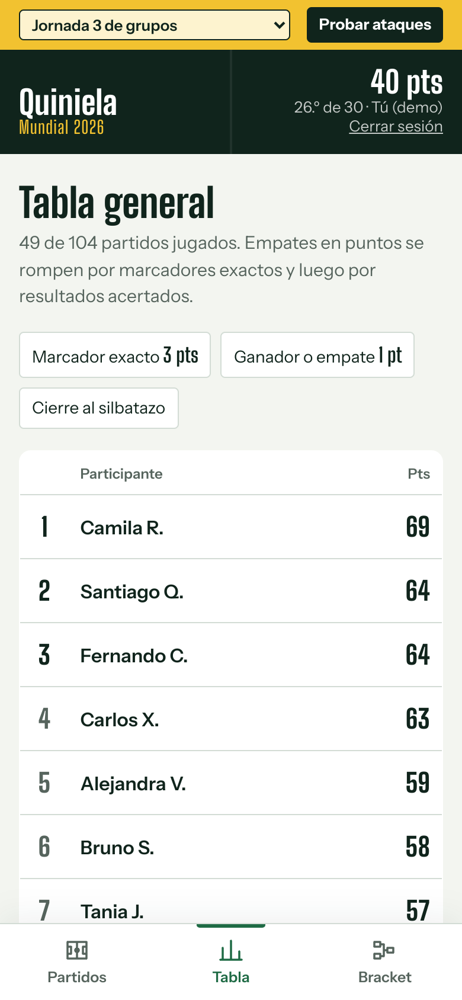
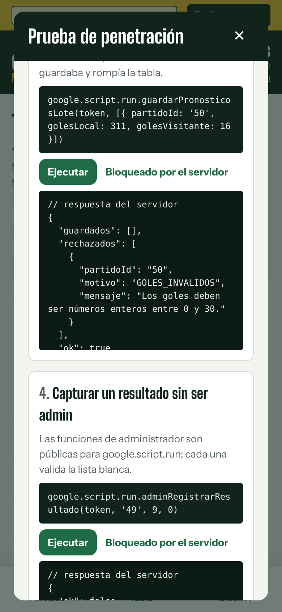
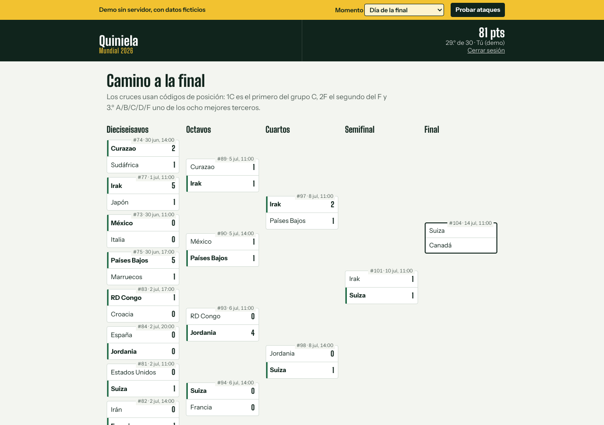
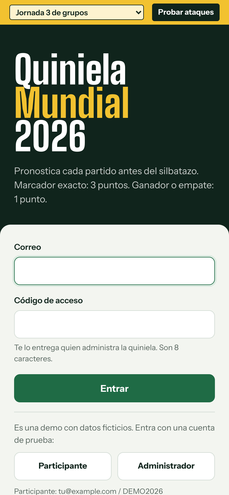
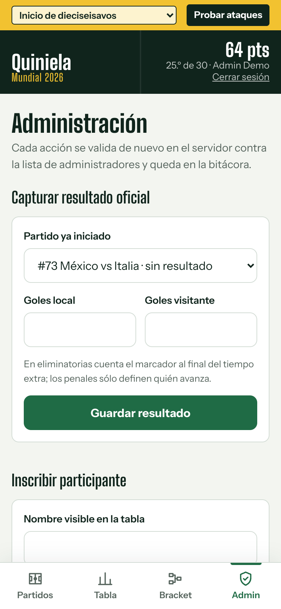
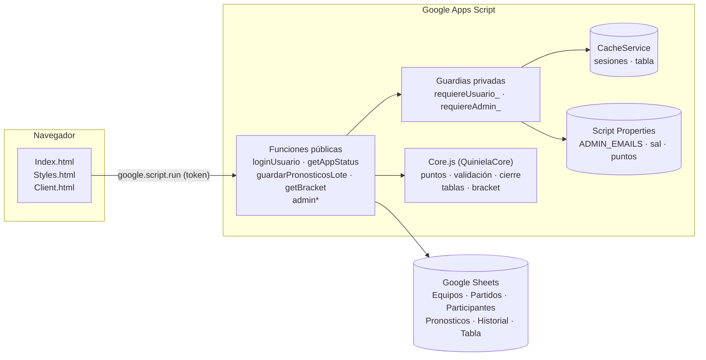
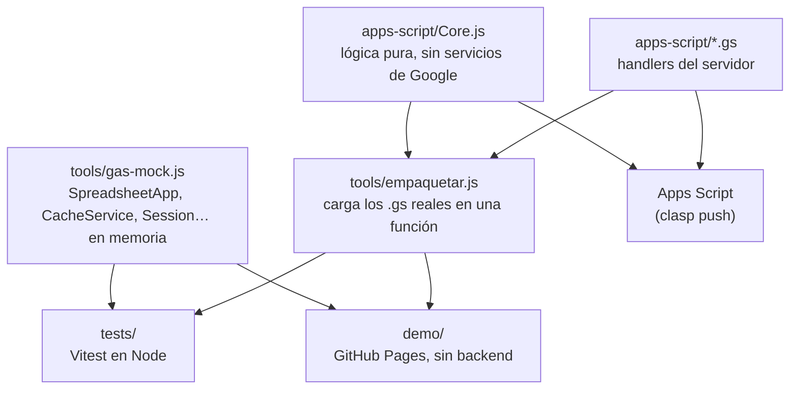

# Quiniela Mundial 2026

Una quiniela del Mundial para un grupo de amigos o de la oficina, hecha en **Google Apps Script** sobre una hoja de Google Sheets: cada quien pronostica los marcadores desde el celular, la captura se cierra al silbatazo, el admin carga los resultados y la tabla se actualiza sola.

Lo más interesante del proyecto no es la quiniela, sino que **la ataqué yo mismo**. Encontré que cualquier participante podía hacerse pasar por otro, ver los pronósticos de todos y capturar resultados oficiales desde la consola del navegador. Este repositorio tiene las correcciones y **una prueba automatizada por cada ataque**. La historia completa está en [**docs/SEGURIDAD.md**](docs/SEGURIDAD.md).

> **English summary.** A World Cup prediction league built on Google Apps Script + Google Sheets, mobile-first, in Spanish. It covers the full 48-team 2026 format: 12 groups, the 8 best third-placed teams and the round of 32, with bracket slots like `1C` / `2F` / `3ABCDF` resolved from the group standings. The focus is security. I pentested my own app through the browser console and fixed identity spoofing, data leakage, missing input validation and unguarded admin endpoints. Each fix has a test that replays the attack against the **real** `.gs` handlers, running in Node with in-memory mocks of `SpreadsheetApp`, `CacheService`, `Session` and the other services. A static demo runs the same server code in the browser. This is a clean-room rebuild of a tool I originally wrote at work; it contains no employer code or data.

| Partidos del día                                      | Tabla general                             | Pentest en la demo                             |
| ----------------------------------------------------- | ----------------------------------------- | ---------------------------------------------- |
|  |  |  |



<details>
<summary>Más capturas: inicio de sesión y panel de administración</summary>

| Inicio de sesión                             | Administración                                      |
| -------------------------------------------- | --------------------------------------------------- |
|  |  |

</details>

## Origen

En el trabajo armé una quiniela para unas 30 personas con Apps Script, porque era lo que teníamos a mano: todos tenían cuenta de Google Workspace y nadie tenía que instalar nada. Funcionó, y la gente se la tomó en serio. Por eso decidí atacarla antes de que alguien más lo hiciera.

Ese código es de mi empleador y no está aquí. Esto es una **reconstrucción desde cero**: mismas ideas, mismos nombres de funciones, mismas correcciones, con marca genérica, datos ficticios y pruebas que la versión original no tenía.

## Qué hace

- **Partidos del día** con una tira de fechas, cuenta regresiva por partido y bloqueo automático al kickoff.
- **Captura por lote**: escribes varios marcadores y los guardas juntos. El servidor acepta o rechaza cada uno por separado y te dice por qué.
- **Tabla general** con desempate por marcadores exactos y luego por resultados acertados; tu fila se resalta.
- **Bracket visual** del formato 2026: tablas de los 12 grupos, mejores terceros y cuadro de dieciseisavos a la final. Mientras la fase de grupos sigue en juego, muestra el cuadro provisional.
- **Panel de administración**: capturar resultados (con penales en eliminatorias), inscribir participantes con un código de acceso de un solo uso y consultar la bitácora.
- **Bitácora de cambios**: cada edición de pronóstico guarda la versión anterior; también se registran resultados, altas, logins fallidos y accesos denegados.
- **Historial de versiones** de la app en el pie de página.

## Reglas de puntuación

| Acierto                                | Puntos | Ejemplo (resultado real 2-1) |
| -------------------------------------- | -----: | ---------------------------- |
| Marcador exacto                        |  **3** | Pronosticaste 2-1            |
| Ganador o empate correcto, marcador no |  **1** | Pronosticaste 3-0 o 1-0      |
| Resultado equivocado                   |      0 | Pronosticaste 1-1 o 0-2      |

- Los puntos no se acumulan: un marcador exacto vale 3, no 3 + 1.
- En eliminatorias cuenta el marcador al final del tiempo extra; los penales sólo deciden quién avanza.
- La captura cierra al kickoff según el reloj del servidor (se puede adelantar con `MINUTOS_CIERRE`).
- **Configurable** desde Script Properties sin tocar código: `PUNTOS_EXACTO`, `PUNTOS_RESULTADO`, `MINUTOS_CIERRE`.
- Desempate en la tabla: puntos, luego exactos, luego aciertos. Si hay empate total, se comparte la posición.

## El formato 2026 y los códigos de posición

48 equipos en 12 grupos (A-L). Pasan los dos primeros de cada grupo y los **8 mejores terceros**: 32 equipos en dieciseisavos. En la hoja `Partidos`, las eliminatorias no llevan equipos sino **códigos de posición**:

| Código   | Significa                                                 | Se resuelve cuando…            |
| -------- | --------------------------------------------------------- | ------------------------------ |
| `1C`     | Primero del grupo C                                       | Termina el grupo C             |
| `2F`     | Segundo del grupo F                                       | Termina el grupo F             |
| `3ABCDF` | Uno de los mejores terceros, de los grupos A, B, C, D o F | Terminan los 12 grupos         |
| `G74`    | Ganador del partido 74                                    | El partido 74 tiene resultado  |
| `P101`   | Perdedor del partido 101 (para el tercer lugar)           | El partido 101 tiene resultado |

Las tablas de grupo se ordenan por **puntos, diferencia de goles y goles a favor** (criterio simplificado: el reglamento de FIFA agrega enfrentamiento directo, juego limpio y otros desempates que aquí no se modelan). Los ocho terceros se reparten entre los ocho cruces `3XXXXX` como un problema de emparejamiento. Hay una prueba que recorre **las 495 combinaciones posibles** de grupos con tercero clasificado y verifica que todas tengan una asignación válida. `QuinielaCore.asignarTerceros` ya acepta la tabla oficial de FIFA como parámetro; conectarla a la configuración está en el roadmap.

## Arquitectura



La idea central es separar **lo que decide** de **lo que toca servicios de Google**:



`Core.js` corre igual en Apps Script, en Node y en el navegador: termina con un `module.exports` protegido que Apps Script ignora. Las pruebas y la demo **no reimplementan nada**: ejecutan los mismos `.gs` que se suben a Google.

```
apps-script/        lo que se sube con clasp
  Core.js           lógica pura (QuinielaCore)
  Config.gs         configuración, Script Properties, respuestas de error
  Hojas.gs          lectura/escritura de la hoja y bitácora
  Auth.gs           login, sesiones, guardias de usuario y de admin
  Partidos.gs       partidos, equipos, cierre por kickoff
  Pronosticos.gs    guardarPronosticosLote
  Puntuacion.gs     tabla general (calcularPuntosGlobales)
  Bracket.gs        getBracket
  Admin.gs          resultados, altas, códigos, bitácora
  Status.gs         getAppStatus
  Setup.gs          setupQuiniela (crea hojas), doGet
  Index.html, Styles.html, Client.html
tests/              Vitest: core, seguridad (un bloque por hallazgo), flujo completo, demo
tools/              mock de Apps Script, empaquetador, build de la demo, capturas
demo/               demo estática (los archivos generados no se versionan)
docs/SEGURIDAD.md   la prueba de penetración
```

## Seguridad

Resumen de [docs/SEGURIDAD.md](docs/SEGURIDAD.md):

| #   | Hallazgo                                                 | Severidad     | Corrección                                                                               |
| --- | -------------------------------------------------------- | ------------- | ---------------------------------------------------------------------------------------- |
| 1   | El servidor confiaba en el correo que mandaba el cliente | Crítica       | Identidad del servidor: `Session.getActiveUser()` o token UUID en `CacheService`         |
| 2   | `getAppStatus` devolvía correos y pronósticos de todos   | Alta          | Listas blancas de campos; sólo tus pronósticos; tabla calculada en el servidor           |
| 3   | Editar pronósticos de partidos ya iniciados              | Ya controlado | `partidoEstaAbierto` con kickoff de la hoja y reloj del servidor; falla cerrado          |
| 4   | Se aceptaba un marcador de 311-16                        | Media         | Enteros de 0 a 30, lote acotado, protección contra fórmulas en Sheets                    |
| 5   | Funciones de admin invocables por cualquiera             | Crítica       | `requiereAdmin_` en la primera línea de cada `admin*`, lista blanca en Script Properties |
| 6   | Toda función de nivel superior es pública en Apps Script | Causa raíz    | Convención de `_` final para privadas; prueba que fija la superficie pública             |

Cada fila tiene un bloque en [`tests/seguridad.test.js`](tests/seguridad.test.js) que repite el ataque contra los handlers reales. En la demo, el botón **Probar ataques** hace lo mismo en vivo.

## Probar la demo

La carpeta `demo/` es una página estática: carga el código del servidor en el navegador, lo conecta a una hoja en memoria con 30 participantes ficticios y reemplaza `google.script.run` por un adaptador local.

```bash
npm install
npm run demo:serve      # construye la demo y la sirve en http://localhost:4173
```

También puedes construirla con `npm run demo:build` y abrir `demo/index.html` directamente.

- Entra como **Participante** o **Administrador** con los botones de la pantalla de inicio.
- El selector de la franja amarilla cambia el **momento del torneo**: jornada 3 de grupos, inicio de dieciseisavos o día de la final. El reloj simulado avanza en tiempo real desde ese momento.
- **Probar ataques** abre el panel con los ataques de la prueba de penetración.

El workflow [`pages.yml`](.github/workflows/pages.yml) publica la demo en GitHub Pages al hacer push a `main`, una vez que se activa Pages con "Source: GitHub Actions" en la configuración del repositorio.

## Instalar en Google Apps Script

Requisitos: Node 20.19 o superior y una cuenta de Google.

1. **Crea la hoja y el proyecto.** Crea una hoja de Google Sheets nueva y abre _Extensiones → Apps Script_. Copia el _ID del script_ desde _Configuración del proyecto_.
2. **Conecta clasp.**
   ```bash
   npm install -g @google/clasp
   clasp login
   cp .clasp.json.example .clasp.json    # pega tu scriptId; .clasp.json no se versiona
   clasp push
   ```
3. **Configura Script Properties** (_Configuración del proyecto → Propiedades del script_):

   | Propiedad          | Valor                                                                                          |
   | ------------------ | ---------------------------------------------------------------------------------------------- |
   | `ADMIN_EMAILS`     | Correos de administradores separados por coma                                                  |
   | `MODO_IDENTIDAD`   | `DOMINIO` (Google Workspace) o `TOKEN` (cuentas personales, por defecto)                       |
   | `PUNTOS_EXACTO`    | Opcional, 3 por defecto                                                                        |
   | `PUNTOS_RESULTADO` | Opcional, 1 por defecto                                                                        |
   | `MINUTOS_CIERRE`   | Opcional, 0 por defecto (cierra al kickoff)                                                    |
   | `SPREADSHEET_ID`   | Opcional, si el script no está ligado a la hoja (requiere cambiar el alcance a `spreadsheets`) |

4. **Ejecuta `setupQuiniela`** desde el editor una vez. Crea las hojas con encabezados, 48 equipos de ejemplo y los 104 partidos (fechas y sedes ilustrativas: reemplázalos por el calendario real en la hoja). También genera `SAL_CODIGOS`.
5. **Despliega.** _Implementar → Nueva implementación → Aplicación web_, "Ejecutar como: yo". En Workspace usa acceso "usuarios de tu dominio" y `MODO_IDENTIDAD=DOMINIO`; con cuentas personales usa `TOKEN` y entrega a cada quien su código desde el panel de admin.
6. **Inscribe participantes** desde el panel de administración. El código de acceso se muestra una sola vez.

El manifiesto pide los alcances mínimos: `spreadsheets.currentonly` (sólo la hoja a la que está ligado el script) y `userinfo.email`.

## Desarrollo

```bash
npm install
npm test               # 111 pruebas: lógica, seguridad, flujo del torneo y build de la demo
npm run lint           # ESLint (los .gs se revisan como scripts de Apps Script)
npm run format:check   # Prettier
npm run demo:build     # genera demo/index.html y demo/servidor.js
npm run screenshots    # regenera docs/capturas (requiere playwright-core y Chromium)
```

El [workflow de CI](.github/workflows/ci.yml) corre lint, formato, pruebas y el build de la demo en cada push y pull request.

## Roadmap

- [ ] Pronósticos de campeón y goleador antes del torneo, con puntos extra.
- [ ] Conectar la tabla de terceros oficial de FIFA (las 495 combinaciones) desde Script Properties.
- [ ] Desempates completos de grupo: enfrentamiento directo y juego limpio.
- [ ] Prueba de humo con `clasp run` contra un despliegue de prueba en CI.
- [ ] Recordatorio por correo con `MailApp` de los partidos sin pronóstico del día siguiente.
- [ ] Modo oscuro.

## Licencia

[MIT](LICENSE) © Carlos (Aloner23)
